<p align="center">
  
</p>

<h1 align="center">Fogu Terminal</h1>

<p align="center">
  <strong>A native terminal for Linux, macOS and Windows with a built-in SSH manager and SFTP browser.</strong><br>
  Written in Rust. No browser engine, no compromises on your daily workflow.
</p>

<p align="center">
  
  
  
  
  
</p>

---

> **Fogu is in beta.** It is used daily, but expect rough edges and breaking changes to the
> configuration format before 1.0. Bug reports and feedback are very welcome.
> **Windows support is alpha.** It builds and runs on Windows, but needs more real-world testing;
> please report Windows-specific issues with your Windows version and steps to reproduce.

## Screenshots

<p align="center">
  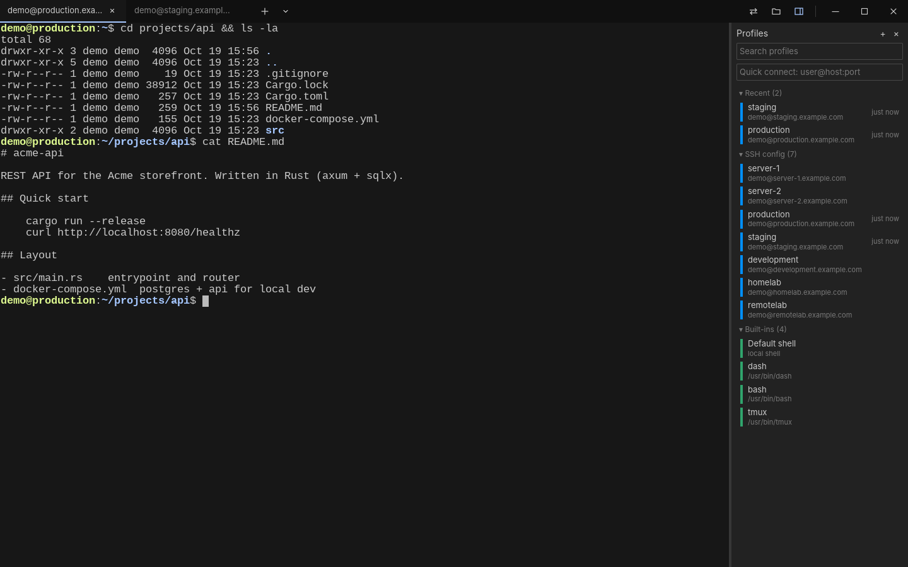
</p>
<p align="center"><em>SSH manager: every host from <code>~/.ssh/config</code>, one click to connect.</em></p>

<p align="center">
  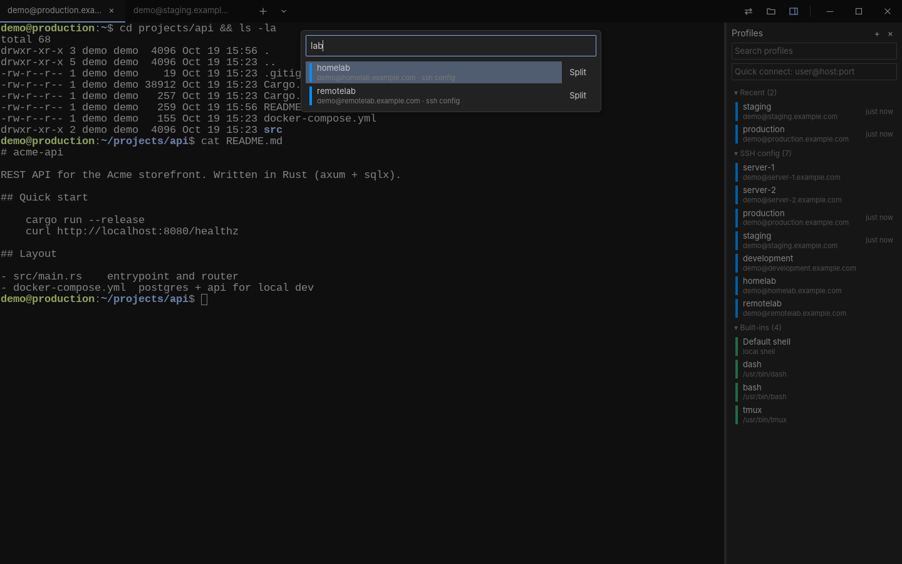
</p>
<p align="center"><em>Quick picker (<code>Ctrl+Shift+E</code>): type a few letters, press Enter.</em></p>

<p align="center">
  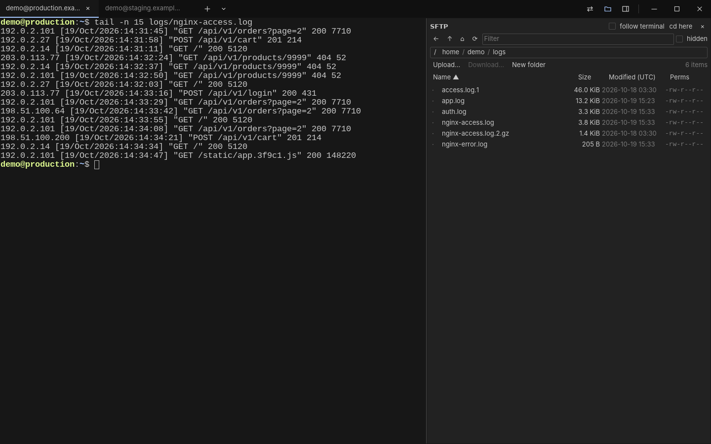
</p>
<p align="center"><em>SFTP panel on the same connection as the shell.</em></p>

<p align="center">
  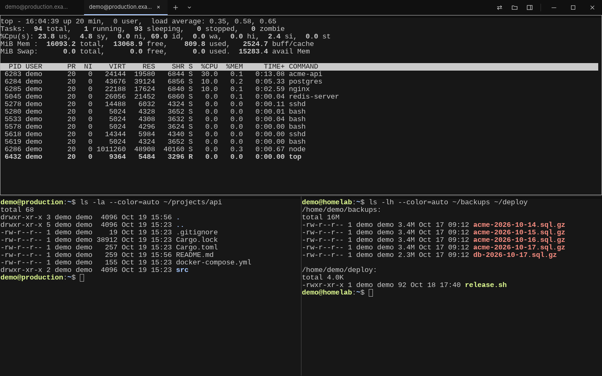
</p>
<p align="center"><em>Split panes, each on its own host.</em></p>

### Settings

<p align="center">
  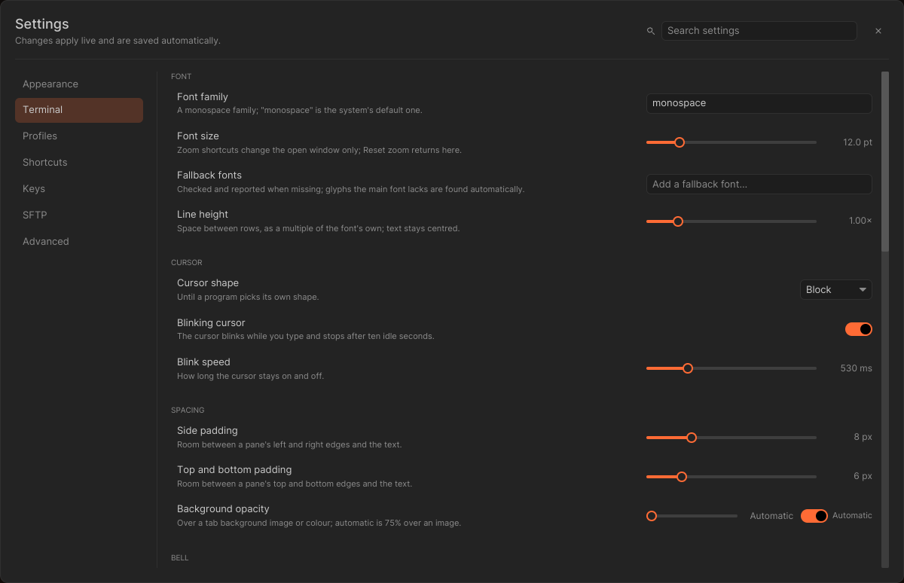
</p>
<p align="center"><em>Settings (<code>Ctrl+,</code>): every change applies live and is saved to
<code>config.toml</code>, comments kept. Search finds any option across the pages.</em></p>

<table>
  <tr>
    <td>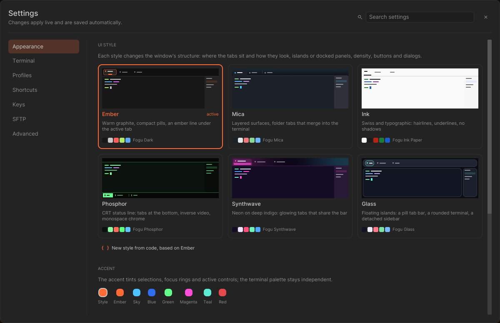</td>
    <td>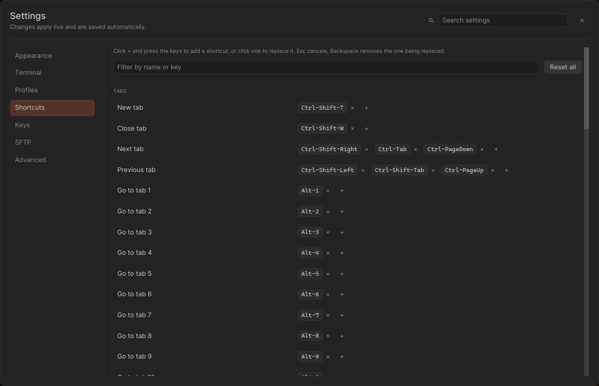</td>
  </tr>
  <tr>
    <td align="center"><em>Appearance: UI styles, accents, palettes</em></td>
    <td align="center"><em>Shortcuts: press the keys, conflicts flagged</em></td>
  </tr>
  <tr>
    <td>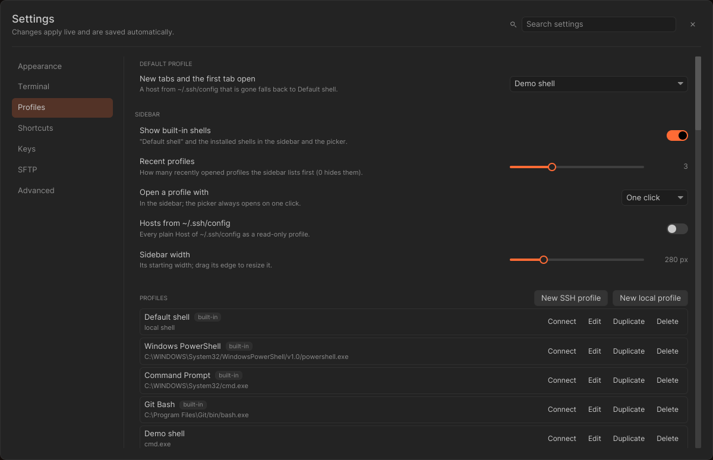</td>
    <td>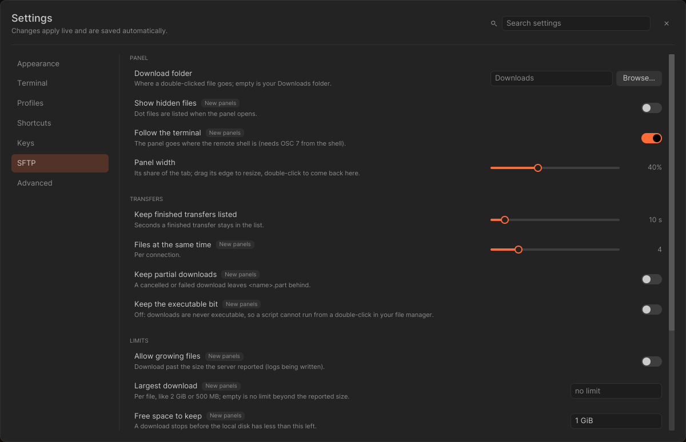</td>
  </tr>
  <tr>
    <td align="center"><em>Profiles: default profile, groups, profile defaults</em></td>
    <td align="center"><em>SFTP: panel, transfers and limits</em></td>
  </tr>
  <tr>
    <td>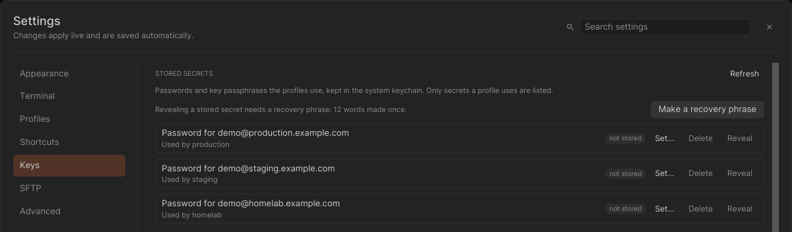</td>
    <td>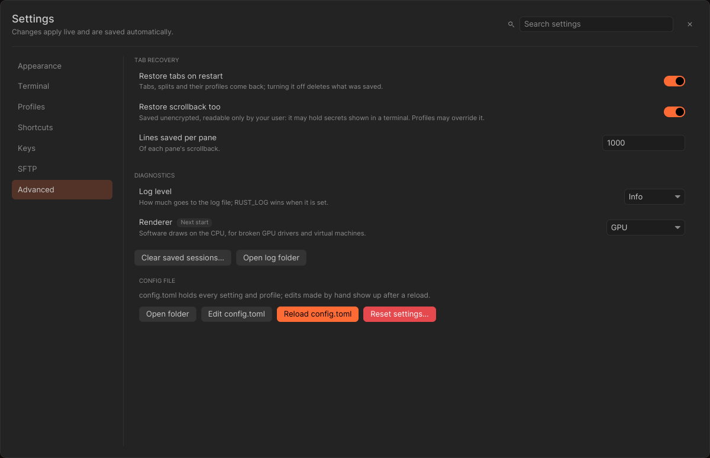</td>
  </tr>
  <tr>
    <td align="center"><em>Keys: stored secrets, known hosts, key files, agent</em></td>
    <td align="center"><em>Advanced: recovery, diagnostics, config file</em></td>
  </tr>
</table>

## Why Fogu

Most terminals that ship a decent SSH manager are web apps in disguise: a few hundred megabytes of
browser engine to draw a grid of characters. The native alternatives are fast, but leave you
juggling `~/.ssh/config`, a separate SFTP client and a password manager.

Fogu is the terminal built for people who live on remote servers. Open the sidebar, click a host,
and you are in a shell. Open the SFTP panel and you are browsing the same machine, on the same
connection, already in the directory your shell is in. Everything starts in about a tenth of a
second and stays out of your way.

*Fogu* means *fire* in Sardinian.

## Features

### Terminal
- GPU rendering with [iced](https://iced.rs) (wgpu), automatic CPU fallback for broken drivers and VMs
- Terminal emulation by [`alacritty_terminal`](https://github.com/alacritty/alacritty): fast, correct, battle-tested
- Tabs with rename, colour and backgrounds (colour or image); split panes, resizable with the mouse
- Drag and drop for tabs, panes and profiles; maximize, equalize and resize from the keyboard
- Scrollback, mouse selection, copy to PRIMARY and CLIPBOARD, safe multi-line paste
- Mouse reporting for TUI apps, with Shift to override
- Clickable links: OSC 8 hyperlinks plus detected URLs and paths, behind a scheme allow-list
- Context menus everywhere, configurable right-click behaviour
- Tab recovery: layout and recent scrollback come back after a restart (opt-out)
- Six UI styles that change the window's structure, not just its colours (tab bar placement and
  shape, docked panels or floating islands, density, buttons and dialogs), each with a paired
  palette; custom styles and colour schemes in TOML
- Colour schemes, fonts, cursor and every key binding configurable
- Line height, pane padding and cursor blink speed; the bell as a flash, a tab badge, a taskbar
  or dock alert and a sound, in any combination

### Settings
- One window for everything (`Ctrl+,`, `Cmd+,` on macOS): Appearance, Terminal, Profiles,
  Shortcuts, Keys, SFTP and Advanced, with a search box that jumps to any option
- Live and saved at once: toggles, lists and sliders apply as you change them, text fields when
  you press Enter or leave them; the file keeps its comments and only the keys you change move
- Fonts, spacing, scrollback, word separators and cursor shape change in the open panes too
- Shortcuts are captured by pressing the keys, with a warning when a chord is taken (and a
  one-click reassign) or is a key the shell needs; `[hotkeys]` keeps only what differs from the
  defaults
- Profiles page: the default profile for new tabs, sidebar options, profile and group management
  and the defaults every local or SSH profile inherits
- Advanced: tab recovery on and off without a restart, the log level of the running app, the
  renderer, and tools to open, reload or reset `config.toml` (a dated backup is written first;
  profiles and groups stay)

### SSH manager
- Sidebar with groups, search and quick connect (`user@host:port`)
- Reads your `~/.ssh/config` live (Host, HostName, User, Port, IdentityFile, ProxyJump,
  ProxyCommand, HostKeyAlias…) — no import step, nothing duplicated
- Full profile editor that edits `config.toml` in place, keeping your comments
- Password, public key, ssh-agent and keyboard-interactive authentication
- Strict `known_hosts` checking: a changed host key is never accepted silently
- Jump hosts, proxy commands, SOCKS5 and HTTP proxies — a proxied profile never falls back to a
  direct connection
- Port forwarding: local, remote and dynamic (SOCKS5), managed live from a dialog
- Agent and X11 forwarding (off by default, clearly flagged when on)
- Connection reuse: tabs, splits and SFTP for the same host share one SSH connection
- Passwords and key passphrases stored in the desktop keyring (Secret Service on Linux, Keychain
  on macOS, Credential Manager on Windows), never in Fogu's config file
- Login scripts, starting directory, remembered directory, automatic reconnect with backoff
- Keys page: set, replace or delete the stored password or passphrase of every profile; review
  and remove the host keys Fogu trusts; list the keys in `~/.ssh`, copy a public key or create a
  new ed25519 key; see what the SSH agent holds

### SFTP browser
- Side panel on the same SSH connection: no second login
- Follows the shell's working directory as you `cd`
- Upload, download, drag and drop, rename, delete, new folder, permissions
- Transfers with progress, cancel and resume
- Hardened against hostile servers: sanitised names, disk-fill protection, downloaded files never
  executable, nothing is ever launched from a remote listing

## Install

Fogu runs on Linux (X11 and Wayland) and macOS (Intel and Apple Silicon), with alpha support for Windows. Build from source with a Rust toolchain
([rustup](https://rustup.rs) picks the pinned version automatically):

```bash
git clone https://github.com/Revdep/Fogu.git
cd Fogu
./scripts/install.sh              # release build, installs for the current user
fogu
```

`./scripts/install.sh --uninstall` removes exactly what was installed. No root needed.

Build dependencies on Debian/Ubuntu: `sudo apt install build-essential pkg-config libudev-dev libxkbcommon-dev libwayland-dev libasound2-dev`.
`libasound2-dev` is only for the bell sound (the default `bell-sound` feature); without it, build
with `cargo build --release -p fogu --no-default-features --features ssh`.

### Windows (alpha)

Install a Rust toolchain and the Visual Studio C++ build tools, then build and launch from
PowerShell:

```powershell
git clone https://github.com/Revdep/Fogu.git
cd Fogu
cargo run --release
```

Local tabs use ConPTY and the default Windows shell; SSH and SFTP are available. Configuration
is stored under `%APPDATA%\fogu` and state under `%LOCALAPPDATA%\fogu`.

### macOS

The same script builds `~/Applications/Fogu.app` (open it from Finder, Launchpad or Spotlight)
and puts `fogu` in `~/.local/bin`. It needs the Xcode command line tools
(`xcode-select --install`). Good to know:

- Fogu is not signed. A binary downloaded rather than built needs
  `xattr -d com.apple.quarantine fogu` before it runs.
- Option + a letter is Meta (`Option+f` moves a word forward); Option + any other key types its
  character, so `@`, `#`, `[` and `~` work on layouts that need Option. With
  `alt_is_meta = false` under `[terminal]`, Option only types characters: layouts that put
  characters on Option + a letter need it (German: `@` is Option+L, `~` is Option+N). Dead keys
  (Option+e and Option+u on a US layout) never reach the terminal.
- `Cmd` + a key that is not a Fogu shortcut does nothing, as in Terminal.app (apps that turn on
  the kitty keyboard protocol still receive it).
- Local shells get `LANG` from the system language (for example `it_IT.UTF-8`) when Fogu was
  started without any locale variable, as it is from Finder or the Dock.
- Stored passwords and passphrases go to the login Keychain (service `fogu` in Keychain
  Access). After a rebuild macOS may ask once to let the new binary read them.
- `Cmd+Q` quits without the final session save: tabs come back, but up to the last 30 seconds
  of scrollback may be missing.
- Release builds turn core dumps off for Fogu (the soft limit, so shells can raise it again), but macOS has no equivalent of Linux's protection
  against another process of yours attaching a debugger.

## Configuration

Fogu works with no configuration. Open Settings (`Ctrl+,`) to change anything from the window,
or edit `~/.config/fogu/config.toml` (`%APPDATA%\fogu\config.toml` on Windows); Settings →
Advanced → **Reload config.toml** picks up edits made by hand. A small `config.toml`:

```toml
[appearance]
ui_theme = "glass"          # fogu (Ember), fluent (Mica), minimal (Ink), retro (Phosphor), synthwave, glass
color_scheme = "Dracula"    # see "Colour schemes" below

[[profiles]]
id = "home-server"
name = "Home server"
type = "ssh"
host = "server.lan"
user = "me"
```

Hosts from `~/.ssh/config` appear in the sidebar automatically.

### Settings keys

Every key has a control in Settings; these are the ones added with the settings pages:

```toml
default_profile = "home-server"   # new tabs and the first tab (a stored, built-in or ssh-config profile)

[appearance]
line_height = 1.0                 # 0.8 to 2.0, a multiple of the font's own
padding_x = 8                     # pane padding in px, 0 to 32, same on both sides
padding_y = 6
cursor_blink_interval_ms = 530    # 100 to 2000

[terminal]
bell = ["badge"]                  # any of "visual", "badge", "attention", "sound"
bell_volume = 0.5                 # 0 to 1

[advanced]
log_level = "info"                # error, warn, info, debug, trace; RUST_LOG wins when set
renderer = "gpu"                  # gpu, or software (like --software-render), at the next start

[hotkeys]
open-settings = ["Ctrl-,", "F12"] # Settings writes only the actions that differ from the defaults
```

Values out of range are clamped where they are used. Font, spacing, scrollback, word separators
and cursor shape apply to open panes; SFTP engine options apply to panels opened afterwards.

### Stored secrets and the recovery phrase

Passwords and key passphrases live in the system keychain, never in `config.toml`. Settings →
Keys can set, replace and delete them. Showing one in clear text needs a recovery phrase:
12 words made once and shown once; only an Argon2id hash of it is kept, in
`reveal-gate.json` in the state directory. If the phrase is lost, **Replace phrase** makes a new
one, and the secrets saved before it can no longer be revealed (they keep working and can still be
replaced or deleted).

The phrase guards Fogu's **Reveal** button only. The keychain itself stays readable by any
program running as your user, which is how Fogu signs in without asking for the phrase.

### UI styles

A UI style sets the window's structure and form; the terminal colours come from the colour
scheme. Pick one in Settings → Appearance (it applies live) or set `appearance.ui_theme`:

| Style | `ui_theme` (aliases) | What it does |
|---|---|---|
| Ember | `fogu` (`ember`) | Warm graphite title bar, compact pill tabs with an ember line under the active one |
| Mica | `fluent` (`mica`, `windows`) | 48 px layered title bar, folder tabs whose active tab merges into the terminal, dialogs with a footer bar |
| Ink | `minimal` (`ink`, `paper`, `swiss`) | Full-bleed 34 px bar, underlined tabs sized to their titles, hairlines only, outlined buttons, dialogs as top sheets |
| Phosphor | `retro` (`phosphor`, `crt`, `terminal`) | Tabs at the bottom as a status line with index numbers and inverse video, monospace chrome, command-line dialogs, hard shadows |
| Synthwave | `synthwave` (`outrun`, `neon`) | Neon gradient bar, glowing tabs that share the bar's width |
| Glass | `glass` (`frost`) | Floating islands: a pill tab bar, a rounded terminal card and a detached sidebar over a canvas |

Every style has a paired palette (Fogu Dark, Fogu Mica, Fogu Ink Paper, Fogu Phosphor,
Fogu Synthwave, Fogu Glass). Switching style also switches the palette while the current one is
the default or another style's pair; a palette you picked yourself stays, and Settings offers
"Use matching palette". `appearance.accent` overrides the style's accent. Accents and muted text
are nudged when a palette would make them unreadable (text 4.5:1, accents 3:1).

### Custom UI styles

Put a TOML file in `styles/` under the Fogu config directory (next to `themes/`), then select it
by its `name`. It `extends` a built-in style (by key, name or alias; default `fogu`) and
overrides any key of any section:

```toml
name = "Night Glass"
extends = "glass"
paired_scheme = "Midnight Ocean"

[color]
accent = "#ffb454"

[tabs]
style = "underline"   # pill, folder, underline, inverse, glow
sizing = "fill"       # fixed, fill, fit
marker = "index"      # dot, index, none

[shadow.floating]
blur = 36

[layout]
geometry = "islands"  # docked, islands
margin = 10
```

Sections and keys (the built-in files in `assets/styles/` list every one):

- `[color]`: `accent`, `secondary` (focus rings, gradient ends), `danger`
- `[surface]`: `bg`, `raised`, `panel`, `canvas`, `border`, `divider`, `dim` as mix recipes
  `{ from = "base", toward = "fg", dark = 0.06, light = 0.04 }` (roles: `base`, `fg`, `bg`,
  `raised`, `panel`, `accent`, `black`, `white`), plus `soft_dark`, `soft_light`, `hover`
- `[shape]`: `card`, `control`, `tab_top`, `tab_bottom`, `dot`, `border`, `focus`
- `[shadow.panel]`, `[shadow.floating]`, `[shadow.tab]`: `x`, `y`, `blur`, `alpha`,
  `tint` (`black`, `accent`, `secondary`), `mix`
- `[bar]`: `placement` (`top`, `bottom`), `height`, `strip`, `fill` (`solid`, `base`, `vertical`,
  `horizontal`), `gradient`, `rule`
- `[tabs]`: `style`, `sizing`, `width`, `min_width`, `max_width`, `marker`, `close` (`always`,
  `hover`, `never`), `separators`, `inset`, `title_size`, `indicator`, `indicator_length`,
  `indicator_color` (`accent`, `fg`)
- `[layout]`: `geometry`, `margin`, `sidebar` (`docked`, `floating`), `density` (`compact`,
  `regular`, `comfy`), `gutter`, `grip`
- `[text]`: `chrome` (`ui`, `mono`), `labels` (`upper`, `sentence`), `active` (`regular`,
  `medium`)
- `[interaction]`: `hover` (`fill`, `inverse`, `outline`), `button` (`filled`, `outline`,
  `text`, `inverse`), `selection` (`fill`, `inverse`)
- `[dialog]`: `placement` (`center`, `top-sheet`, `command-bar`), `footer`, `backdrop`

Out-of-range numbers are clamped and reported; unknown keys, a name that a built-in style
already answers to, or a name already taken by an earlier file skip the file with a warning,
never stopping Fogu. Press **Reload styles and palettes** in Settings → Appearance after editing.

You can also write one without leaving Fogu: in Settings → Appearance, **New style from code**
(or **New palette from code**) opens an editor prefilled from the active style or palette. The
file is checked as you type (syntax, unknown keys, name clashes, clamped values) and previewed
live; **Save and apply** writes it to `styles/` (or `themes/`) and switches to it. Custom styles
and palettes get an **Edit** button that reopens their file.

### Custom terminal colour schemes

Put a TOML file in `themes/` under the Fogu config directory, then select it by its `name`:

- Linux: `~/.config/fogu/themes/my-theme.toml`
- Windows: `%APPDATA%\fogu\themes\my-theme.toml`
- With `--config-dir`: `<dir>/themes/my-theme.toml`

```toml
name = "Midnight Ocean"
extends = "Fogu Dark"

bg = "#0b1020"
fg = "#d8dee9"
cursor = "#88c0d0"
```

`extends` must name one of the built-in schemes (`Fogu Dark`, `Fogu Light`, `Solarized Dark`,
`Dracula`, `Fogu Mica`, `Fogu Ink Paper`, `Fogu Phosphor`, `Fogu Synthwave`, `Fogu Glass`);
every colour you omit is inherited. A file without `extends` must provide all fields:

```toml
name = "Midnight Ocean"
fg = "#d8dee9"
bg = "#0b1020"
cursor = "#88c0d0"
cursor_text = "#0b1020"
selection_bg = "#2e3440"
selection_fg = "#eceff4"
ansi = [
  "#0b1020", "#ff6b6b", "#a3be8c", "#ebcb8b",
  "#81a1c1", "#b48ead", "#88c0d0", "#e5e9f0",
  "#4c566a", "#ff8787", "#b9d99a", "#f0d9a0",
  "#9bb8d3", "#c9a6d6", "#a3d8e8", "#ffffff",
]
```

Files are loaded at startup, sorted by file name. Invalid files are skipped with a warning.
Custom schemes cannot reuse a built-in name; the first custom file claiming a name wins.

You can also select a palette and press **Reload styles and palettes** in Settings → Appearance, without
restarting. If you edit the TOML on disk, press Reload themes to pick up the changes.

### Default keys

| Action | Linux | macOS |
|---|---|---|
| New tab / close tab | `Ctrl+Shift+T` / `Ctrl+Shift+W` | `Cmd+T` / `Cmd+W` |
| Go to tab 1-9 | `Alt+1`..`Alt+9` | `Cmd+1`..`Cmd+9` |
| Profile picker | `Ctrl+Shift+E` | `Cmd+E` |
| Profiles sidebar / SFTP panel | `Ctrl+Shift+M` / `Ctrl+Shift+O` | `Cmd+Shift+M` / `Cmd+Shift+O` |
| Split right / split down | `Ctrl+Shift+S` / `Ctrl+Shift+D` | `Cmd+Shift+D` / `Cmd+D` |
| Move between panes | `Ctrl+Alt+Arrows` | `Cmd+Option+Arrows` |
| Copy / paste | `Ctrl+Shift+C` / `Ctrl+Shift+V` | `Cmd+C` / `Cmd+V` |
| Clear | | `Cmd+K` |
| Zoom | `Ctrl+=` / `Ctrl+-` / `Ctrl+0` | `Cmd+=` / `Cmd+-` / `Cmd+0` |
| Full screen | `F11` | `Ctrl+Cmd+F` |
| Settings | `Ctrl+,` | `Cmd+,` |

Windows uses the Linux keys. Every action can be rebound in Settings → Shortcuts or under
`[hotkeys]`. `Cmd` and `Option` are accepted as modifier
names on every system (the same keys as `Meta` and `Alt`); macOS shows them that way.

### Command line

```
fogu [--config-dir PATH] [--software-render] [--no-recovery]
```

## Under the hood

Fogu is a Cargo workspace of five crates with one owner per concern:

| Crate | Role |
|---|---|
| `fogu-term` | Terminal state over `alacritty_terminal`, input encoding, OSC parsing, links |
| `fogu-session` | Local PTY and SSH sessions on Tokio: `russh`, SFTP, forwarding, proxies, keyring |
| `fogu-core` | Config, profiles, `~/.ssh/config` parsing, key map, colour schemes, split tree |
| `fogu-ui` | The iced application: tabs, panes, sidebar, SFTP panel, dialogs |
| `fogu` | The binary: command line, logging, crash log |

Design choices:

- **Pure Rust, no C crypto.** SSH via [`russh`](https://github.com/Eugeny/russh) on `ring`;
  `unsafe_code = "forbid"` for the whole workspace.
- **Remote text is attacker input.** Everything a server sends — terminal output, file names,
  banners, error messages — is sanitised before it reaches the UI or the logs.
- **Secrets stay secret.** Passwords live in `secrecy` types, never in messages, logs or errors,
  and are stored only in the desktop keyring.
- **Supply chain gate.** `cargo deny` checks advisories, licences and sources on every build; no
  vulnerability advisory is ever ignored.
- **Tested against the real thing.** Integration tests start a throwaway OpenSSH `sshd` and an
  in-process hostile SFTP server; parsers are fuzzed.

## Development

```bash
./scripts/check.sh    # fmt, clippy -D warnings, fuzz build, nextest, doc tests, cargo deny
cargo run             # debug build
```

The SSH integration tests need `sshd`, `ssh-keygen`, `ssh-agent` and `ssh-add`; without them they
are skipped.

## Contributing

Fogu is open to contributions: bug reports, ideas, documentation and code are all welcome.

- **Bugs and ideas:** open an [issue](https://github.com/Revdep/Fogu/issues) with steps to
  reproduce, your distribution and desktop (X11 or Wayland), or your macOS version.
- **Code:** fork, branch, and open a pull request. Keep changes focused, add a test for new
  logic, and make sure `./scripts/check.sh` passes.
- **Security issues:** please report them privately through
  [GitHub security advisories](https://github.com/Revdep/Fogu/security/advisories/new) rather
  than a public issue.

## Acknowledgements

Fogu was inspired by [Tabby](https://github.com/Eugeny/tabby) and by many other terminals that
showed what a modern terminal can be. It stands on the shoulders of
[Alacritty](https://github.com/alacritty/alacritty), [iced](https://iced.rs),
[russh](https://github.com/Eugeny/russh) and [Tokio](https://tokio.rs). Third-party notices are in
[`THIRD_PARTY_LICENSES`](THIRD_PARTY_LICENSES).

## License

[MIT](LICENSE)
